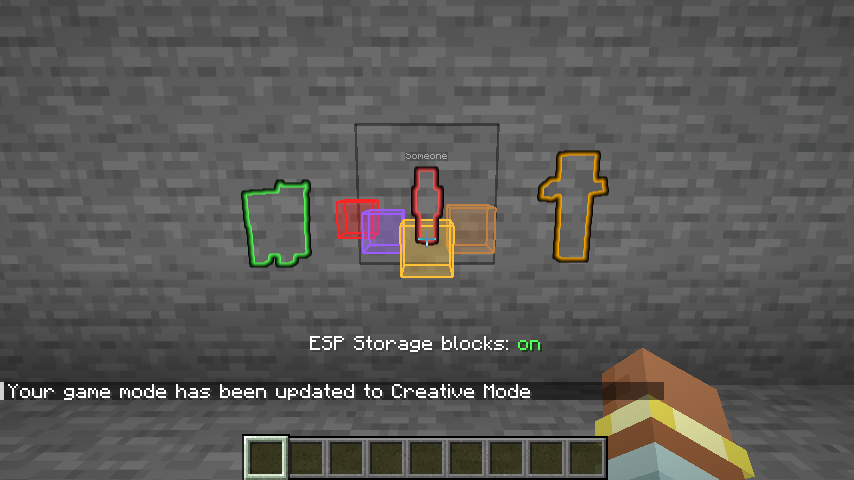

# Light ESP

Client-side Fabric mod for Minecraft 26.2 that shows players, mobs and storage blocks through
walls. Each of the three switches on and off on its own.

> [!WARNING]
> **ESP isn't allowed on most servers.** Seeing players, mobs or chests through walls counts as
> cheating under most servers' rules, and anti-cheat plugins or staff can ban you for it. Only use
> Light ESP in single player, or on servers whose rules clearly allow it, like many anarchy servers.
> Check the rules first; you're responsible for where you use it.



## What it shows

| Switch | Shows |
| --- | --- |
| **Players** | A red outline on other players |
| **Mobs** | An orange outline on hostile mobs, green on the rest |
| **Storage blocks** | Boxes on chests (gold), trapped chests (red-orange), ender chests (purple), shulker boxes (pink), barrels (brown), spawners (red), and hoppers, droppers, dispensers, crafters and furnaces (gray) |
| **Ender pearls** | An aqua outline on thrown ender pearls, so you can see where someone pearled |
| **Nether portals** | A purple box around each lit nether portal |

All five start off.

## Switching

- **Commands:**
  - `/esp players`, `/esp mobs`, `/esp blocks`, `/esp pearls` and `/esp portals` switch one on or off. Add `on` or `off` to set it.
  - `/esp off` switches everything off, and `/esp` shows what's on.
- **Keys:** under **Light ESP** in Controls there's a key for each switch and one for the screen.
  None are bound at first.
- **Screen:** `/esp menu`, its key, or Light ESP's config button in
  [Mod Menu](https://modrinth.com/mod/modmenu).

The switches are saved in `config/lightesp.properties`.

## How it works

It only shows what the server already sends your game.
- **Players and mobs:** these use the game's own glowing outline, the one from spectral arrows,
  which already draws through walls. You never get an outline yourself. Anything that's really
  glowing keeps its own colour, so you can still tell.
- **Storage blocks:** every half second it lists the storage blocks in your loaded chunks. Boxes
  are drawn with the game's built-in debug drawing, set to draw on top of everything. It shows
  at most the 1500 nearest.

## Building

Requires JDK 25.

```bash
./gradlew build
```

`./gradlew runClientGameTest` puts a husk, a cow, a stand-in player and storage blocks behind a
stone wall. It checks the outline colours, that you and a sign aren't marked, that a mob glowing
for real keeps its colour, the screen and saved switches, and that `/esp off` clears everything.
